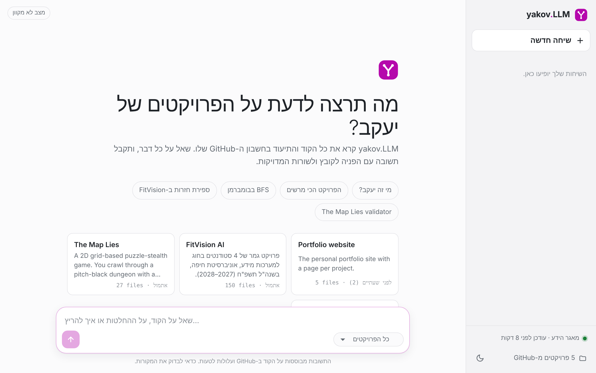
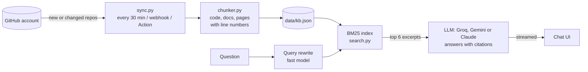
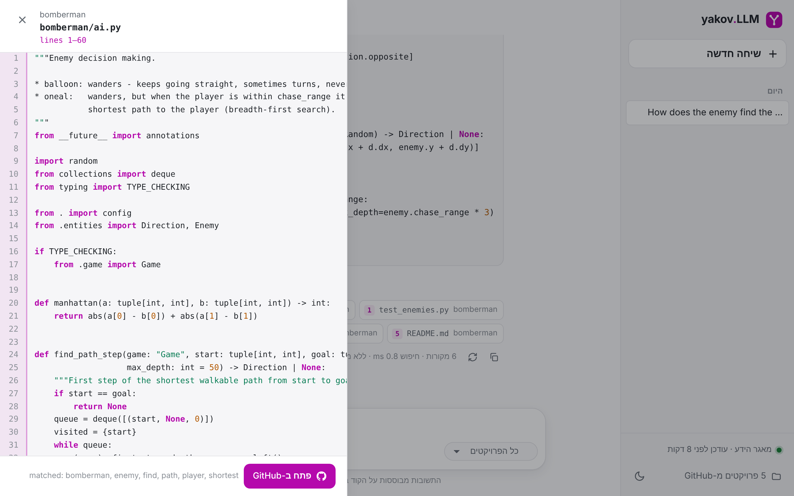

# yakov.LLM

**עוזר AI שמכיר את כל הפרויקטים שלי ב-GitHub.** שואלים אותו על הקוד, על החלטות התכנון או איך להריץ משהו, ומקבלים תשובה עם הפניה לקובץ ולשורות המדויקות. כשאני מוסיף פרויקט או דוחף שינוי, הוא מתעדכן לבד.

An AI assistant that knows every project in my GitHub account. Ask about the code, the design decisions or how to run something, and the answer cites the exact file and lines. When I add a project or push a change, it updates itself.

**▶ Live app:** https://yakov-ashgar27.github.io/yakov.LLM/ (installable on phone and desktop; search runs in the browser, written answers come from the hosted server)



📐 **System design:** [DFD (levels 0–1) and data model](docs/DIAGRAMS.md), drawn from the code.

## Where to look in the code

- [`yakovllm/search.py`](yakovllm/search.py): BM25 written from scratch, with field weighting, repo focus and per-file diversity.
- [`yakovllm/tokenizer.py`](yakovllm/tokenizer.py): one tokenizer for Hebrew and code. It splits `findPathStep` into its words and strips Hebrew prefixes (ו, ה, ב, ל…).
- [`yakovllm/facts.py`](yakovllm/facts.py): reads the code itself (Python with `ast`, JS/TS/Java with careful patterns) and writes a fact card for every function, class, API route and DB table, every file, and every project: dependencies, run commands, tests, CI, endpoints, settings.
- [`yakovllm/memory.py`](yakovllm/memory.py): remembers who it talked with and what they said, kept apart from the knowledge base as unverified notes.
- [`yakovllm/sync.py`](yakovllm/sync.py): follows a GitHub account and re-indexes only the repos that changed, then swaps the live index without a restart.
- [`web/engine.js`](web/engine.js): the same search engine in JavaScript, so the static demo needs no server. A test checks that both return identical results.
- [`eval/`](eval/): 38 questions with known answers, and the script that scores retrieval.

## How it works



1. **Ingest.** Every text file that helps answer questions (source code, Markdown, HTML pages, config) is split into chunks that keep their repo, path and line range. Markdown is split by headings, code into 60-line windows that prefer to end on a blank line, HTML pages into visible text. Each repo also gets an overview chunk with its summary, file types and folders.
2. **Search.** A question is tokenized the same way and scored with BM25. Hebrew words are also mapped to the English words the code uses ("אויב" → `enemy`), because a Hebrew question about English code otherwise shares no words with it. With an API key, a fast model also suggests search keywords and probable function names.
3. **Answer.** The six best excerpts go to the model with the conversation, and the model must cite them as `[1]`, `[2]`. The model is pluggable: Claude, or free options (open models on Groq, Gemini Flash), or any OpenAI-compatible endpoint. In the UI each citation opens the cited lines, highlighted, with a link to the same lines on GitHub.
4. **Code facts.** Raw code answers questions asked in the code's words. People ask in their own words ("where is the password hashed?", "what does it depend on?", "who calls this?"), so every push also regenerates fact cards from the code: one per function, class, method, React component, API route and database table (signature, docstring, file and lines, what it calls, where it is used), one per file (role, definitions, imports), and a few per project (dependencies, how to run, tests and CI, endpoints, tables, environment variables, folder structure). There are about 5,000 cards across 11 projects. They are generated, never hand-written, so they can't go stale.
5. **Your files too.** Attach files or a whole folder (Word, PDF, PowerPoint, Excel, text, code). They are read into text (Office files in the browser, PDF on the server), searched with the same engine, and their best passages go to the model next to the project sources. So you can ask "which project fits this job description?".
6. **Memory.** The app remembers who it talked with (a random id the browser keeps, plus a name if one is given) and their earlier questions, so a returning visitor is greeted with context. What people *claim* is stored as an unverified note for Yakov to review on `/admin.html`, and never becomes part of the knowledge base. A name from another device only reveals that someone by that name talked before, never what they said.
7. **A real chat app.** Answers reply in the language you write in (or the one you pick), and a reply of just "2" picks option 2 of the last answer. Sources stay folded under each answer. Long-press a chat to rename, pin, save or delete it; search all chats; temporary chats that are neither saved nor remembered; a profile with name and photo; standing instructions ("answer in 3 bullets"); 👍/👎; read aloud; voice typing; select text in an answer to ask about it; a "what do you remember about me?" screen with a delete button; drafts that survive closing the app. Zip files and very long pastes become attachments.
8. **Folders.** Like Projects in the big chat apps: a folder has a name, its own instructions and up to 200 files (lectures, exercises, PDFs, slides, a whole directory or a zip). Every chat opened in it answers from those files, and its chats live inside it. Folders and chats can be pinned.
9. **Every project, when asked.** "The data structures of all the projects" or "of all of them" pulls the best excerpts from each project in turn, so the answer covers every one instead of the three that happened to rank highest; naming four projects covers exactly those.
10. **Fast and thorough.** The model is asked to think as little as it allows (retrieval already did the hard work), gets fewer, tighter excerpts, and a ping every 10 minutes keeps the free server awake, so answers start in seconds. Answers are detailed and end with 2-3 numbered follow-ups you can tap or pick by number.
11. **Stay current.** See below.



## Staying in sync with GitHub

There are three ways, and they work together:

| How | When it runs | Setup |
| --- | --- | --- |
| **Server sync** | Every 30 minutes, and on demand from the projects panel | Set `GITHUB_USER` |
| **Webhook** | Instantly on every push to a repo that has the webhook | Payload URL `…/api/webhook/github`, content type JSON, secret = `WEBHOOK_SECRET` |
| **GitHub Action** ([`refresh.yml`](.github/workflows/refresh.yml)) | Every 6 hours, from the Actions tab, or from a push in any project | Nothing. For instant runs, copy [`docs/notify-yakov-llm.yml`](docs/notify-yakov-llm.yml) into a project |

Each sync lists the account's public repos and compares each repo's `pushed_at` time with the stored one. A new repo is cloned and indexed, a changed repo is pulled and re-indexed (only that repo), and a deleted or archived repo is dropped. If GitHub can't be reached, the old index keeps serving.

## Results

Retrieval measured on [38 questions](eval/questions.json) (20 in Hebrew, 18 in English) over 11 repos, 750 files and about 7,200 chunks. A question is a hit when the file that holds the answer is in the top results.

| Setup | Hit@1 | Hit@5 | MRR | Hit@5 Hebrew | Hit@5 English | ms/query |
| --- | --- | --- | --- | --- | --- | --- |
| BM25 (plain tokens) | 45% | 76% | 0.57 | 75% | 78% | 1.0 |
| BM25 + Hebrew→English glossary | 50% | **89%** | **0.65** | **95%** | 83% | 1.4 |

The glossary raises Hebrew recall from 75% to 95%. These numbers don't include the model keyword rewrite, which needs an API key at evaluation time. `python eval/run_eval.py` prints the table and lists the misses.

### Everyday questions

[`eval/question_bank.json`](eval/question_bank.json) holds the questions people actually ask about a project ("what is it?", "how do I run it?", "how many lines of code?", "what was hardest?", follow-ups like "and how do I run it?"), in Hebrew and English. They are asked about every project, 234 questions in all, plus 8 questions about the whole account. `python eval/run_bank.py` checks what the model gets to read:

| Check | Result |
| --- | --- |
| The project's fact sheet (summary, languages, lines of code, links) is in the context | 100% |
| Excerpts come from the project that was asked about | 100% |
| Follow-up questions stay on the project of the conversation | 100% |
| Questions about the whole account get the all-projects overview | 100% |

[`eval/run_symbols.py`](eval/run_symbols.py) generates questions about randomly sampled functions, classes and files, in Hebrew and English, often with the identifier written as words ("find path step"), and checks that the right file reaches the model: **93%** of 750 questions. The misses are names like `__init__` that are ambiguous by nature.

The bank isn't a list of canned answers. It checks that whatever is asked, the model reads the right project, so it can answer in its own words.

## Run it

Python 3.10+ is all you need, with **no dependencies** to install.

```bash
git clone https://github.com/yakov-ashgar27/yakov.LLM && cd yakov.LLM
export GROQ_API_KEY=gsk_...              # free written answers (or ANTHROPIC_API_KEY / GEMINI_API_KEY)
python -m yakovllm                       # http://localhost:8000
```

Without any key the app still works: answers are the matching excerpts. Reading PDF attachments needs `pip install pypdf` (the Docker image has it); everything else is standard library.

Memory is kept in `.cache/memory.json`. A free host wipes its disk on each deploy, so to keep it, create a **private** repo and set `MEMORY_REPO=owner/name` and `MEMORY_TOKEN` (a fine-grained token with Contents read & write on that repo only). Set `ADMIN_TOKEN` to read it at `/admin.html`.

| Provider | Key | Cost | Default model |
| --- | --- | --- | --- |
| Groq | `GROQ_API_KEY` | Free tier, no card | `openai/gpt-oss-120b` |
| Google Gemini | `GEMINI_API_KEY` | Free tier | `gemini-flash-latest` |
| Anthropic | `ANTHROPIC_API_KEY` | Paid | `claude-sonnet-5-5` |
| Any OpenAI-compatible API | `LLM_API_KEY` + `LLM_BASE_URL` | Varies | set `LLM_MODEL` |

[](https://render.com/deploy?repo=https://github.com/yakov-ashgar27/yakov.LLM)

On Windows you can double-click `run.bat` instead (it reads `.env`). To use Docker, run `docker build -t yakov-llm . && docker run -p 8000:8000 --env-file .env yakov-llm`. Render deploys `render.yaml` in one click.

To index a different account, run:

```bash
python -m yakovllm.ingest --github <user>          # only new or changed repos
python -m yakovllm.ingest --github <user> --force  # rebuild everything
python -m yakovllm.ingest --local ~/code/my-repo   # local folders
```

Settings are in [`.env.example`](.env.example).

## Tests

```bash
pip install pytest && python -m pytest -q
```

There are 50 tests. They cover the tokenizer, the chunker (line numbers must match the source exactly), BM25 ranking, and GitHub sync against real temporary git repos (add, update, remove, and network failure). They also cover the HTTP API against fake Claude and OpenAI-compatible servers that speak their streaming protocols, webhook signatures, rate limiting, CORS for the static demo, identical Python and JavaScript search results on every evaluation question, the fact extractor, reply language and numbered-option picks, temporary chats, feedback and "forget me", memory (recall, unverified notes, never touching the knowledge base, name-only recall across devices), attachments and Word/PowerPoint/Excel/PDF extraction, and guards that fail CI if Hit@5 drops below 80% or the auto-generated symbol questions drop below 90%.

## Design decisions

- **BM25 instead of embeddings.** The corpus is small, about 7,000 chunks. Code questions use exact identifiers (`find_path_step`, `RBAC`), where keyword search is strong. BM25 runs in 1 ms with no model download, and it runs in the browser too. Cross-language recall, the usual weakness, is handled by the glossary and the query rewrite. The evaluation set is there to show when embeddings start to pay off.
- **Facts generated from code, not written by hand.** A hand-written FAQ goes stale on the next push and only covers the questions someone thought of. Cards extracted from the code cover every function and file and are rebuilt on every push.
- **What visitors say is never knowledge.** The knowledge base is built only from the repos. Visitor claims go to a separate store, marked unverified, for a human to judge.
- **Standard library only.** The server, the model streaming clients and the search engine have no dependencies (PDF reading is the one optional extra), so the project runs anywhere and is easy to read end to end.
- **One engine, two runtimes.** The JavaScript port lets the demo work as a single static file. A parity test keeps both runtimes in lockstep.
- **Grounded answers.** The prompt requires a citation for every claim about the projects and an honest "not in the sources". The UI makes each citation one click away from the real lines.

## Project structure

```
yakovllm/
  tokenizer.py    Hebrew + code tokenizer, glossary, repo aliases
  chunker.py      files -> chunks with line numbers
  facts.py        code facts: symbol, file and project cards
  memory.py       visitors, their questions and unverified notes
  dialog.py       reply language, "2" means option 2
  extract.py      text from Word, PowerPoint, Excel and PDF
  ingest.py       clone/read repos -> data/kb.json
  sync.py         incremental GitHub sync, live index swap
  search.py       BM25 index
  llm.py          streaming clients (Claude, Groq, Gemini, OpenAI-compatible), prompts, offline mode
  server.py       HTTP server: UI, /api/chat (SSE), /api/search, /api/sync, webhook
web/              chat UI (vanilla JS): app.js, engine.js, files.js, markdown.js, style.css, admin.html
eval/             questions.json, run_eval.py
tests/            pytest suite
scripts/          build_demo.py (single-file demo), build_offline_kb.py
.github/workflows ci.yml, refresh.yml (sync + GitHub Pages)
```

## API

| Method | Path | What it does |
| --- | --- | --- |
| GET | `/api/health` | Mode, model, index size, sync status |
| GET | `/api/repos` | Indexed repos with summaries and last push |
| GET/POST | `/api/search?q=…&repo=…&k=…` | Raw search results with scores and matched terms |
| POST | `/api/chat` | `{messages, repo?, attachments?, visitor?, chat?}` → Server-Sent Events: `meta` (sources), `delta` (text), `done` |
| POST | `/api/extract` | File bytes (name in `X-Filename`) → `{text}` for Word, PowerPoint, Excel, PDF |
| POST | `/api/feedback` | `{visitor, chat, vote: up/down, question, answer}` |
| POST | `/api/memory/me`, `/api/memory/forget` | What it remembers about this visitor, and deleting it |
| GET | `/api/memory` | Visitors, questions and unverified notes (`Authorization: Bearer <ADMIN_TOKEN>`) |
| POST | `/api/sync` | Check GitHub now (with `SYNC_TOKEN` set, needs `Authorization: Bearer <token>`) |
| POST | `/api/webhook/github` | GitHub webhook (HMAC-SHA256 verified) |

MIT License · Yakov Ashgar
