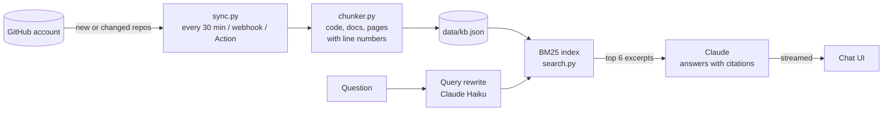

# yakov.LLM

**עוזר AI שמכיר את כל הפרויקטים שלי ב-GitHub.** שואלים אותו על הקוד, על החלטות התכנון או איך להריץ משהו, ומקבלים תשובה עם הפניה לקובץ ולשורות המדויקות. כשאני מוסיף פרויקט או דוחף שינוי, הוא מתעדכן לבד.

An AI assistant that knows every project in my GitHub account. Ask about the code, the design decisions or how to run something, and the answer cites the exact file and lines. When I add a project or push a change, it updates itself.

**▶ Live demo:** https://yakov-ashgar27.github.io/yakov.LLM/ (search runs in the browser; written answers need the server below with a Claude API key)


## Where to look in the code

- [`yakovllm/search.py`](yakovllm/search.py): BM25 written from scratch, with field weighting, repo focus and per-file diversity.
- [`yakovllm/tokenizer.py`](yakovllm/tokenizer.py): one tokenizer for Hebrew and code. It splits `findPathStep` into its words and strips Hebrew prefixes (ו, ה, ב, ל…).
- [`yakovllm/sync.py`](yakovllm/sync.py): follows a GitHub account and re-indexes only the repos that changed, then swaps the live index without a restart.
- [`web/engine.js`](web/engine.js): the same search engine in JavaScript, so the static demo needs no server. A test checks that both return identical results.
- [`eval/`](eval/): 38 questions with known answers, and the script that scores retrieval.

## How it works



1. **Ingest.** Every text file that helps answer questions (source code, Markdown, HTML pages, config) is split into chunks that keep their repo, path and line range. Markdown is split by headings, code into 60-line windows that prefer to end on a blank line, HTML pages into visible text. Each repo also gets an overview chunk with its summary, file types and folders.
2. **Search.** A question is tokenized the same way and scored with BM25. Hebrew words are also mapped to the English words the code uses ("אויב" → `enemy`), because a Hebrew question about English code otherwise shares no words with it. With an API key, a fast model also suggests search keywords and probable function names.
3. **Answer.** The six best excerpts go to Claude with the conversation. Claude must cite them as `[1]`, `[2]`. In the UI each citation opens the cited lines, highlighted, with a link to the same lines on GitHub.
4. **Stay current.** See below.


## Staying in sync with GitHub

There are three ways, and they work together:

| How | When it runs | Setup |
| --- | --- | --- |
| **Server sync** | Every 30 minutes, and on demand from the projects panel | Set `GITHUB_USER` |
| **Webhook** | Instantly on every push to a repo that has the webhook | Payload URL `…/api/webhook/github`, content type JSON, secret = `WEBHOOK_SECRET` |
| **GitHub Action** ([`refresh.yml`](.github/workflows/refresh.yml)) | Every 6 hours, from the Actions tab, or from a push in any project | Nothing. For instant runs, copy [`docs/notify-yakov-llm.yml`](docs/notify-yakov-llm.yml) into a project |

Each sync lists the account's public repos and compares each repo's `pushed_at` time with the stored one. A new repo is cloned and indexed, a changed repo is pulled and re-indexed (only that repo), and a deleted or archived repo is dropped. If GitHub can't be reached, the old index keeps serving.

## Results

Retrieval measured on [38 questions](eval/questions.json) (20 in Hebrew, 18 in English) over 5 repos, 238 files and 602 chunks. A question is a hit when the file that holds the answer is in the top results.

| Setup | Hit@1 | Hit@5 | MRR | Hit@5 Hebrew | Hit@5 English | ms/query |
| --- | --- | --- | --- | --- | --- | --- |
| BM25 (plain tokens) | 50% | 79% | 0.60 | 70% | 89% | 0.4 |
| BM25 + Hebrew→English glossary | 53% | **87%** | **0.67** | **85%** | 89% | 0.6 |

The glossary raised Hebrew recall from 70% to 85%. These numbers don't include the Claude keyword rewrite, which needs an API key at evaluation time. `python eval/run_eval.py` prints the table and lists the misses.

## Run it

Python 3.10+ is all you need, with **no dependencies** to install.

```bash
git clone https://github.com/yakov-ashgar27/yakov.LLM && cd yakov.LLM
export ANTHROPIC_API_KEY=sk-ant-...      # optional: without it, answers are the matching excerpts
python -m yakovllm                       # http://localhost:8000
```

On Windows you can double-click `run.bat` instead (it reads `.env`). To use Docker, run `docker build -t yakov-llm . && docker run -p 8000:8000 --env-file .env yakov-llm`. Render deploys `render.yaml` in one click.

To index a different account, run:

```bash
python -m yakovllm.ingest --github <user>          # only new or changed repos
python -m yakovllm.ingest --github <user> --force  # rebuild everything
python -m yakovllm.ingest --local ~/code/my-repo   # local folders
```

Settings are in [`.env.example`](.env.example).

## Tests

```bash
pip install pytest && python -m pytest -q
```

There are 25 tests. They cover the tokenizer, the chunker (line numbers must match the source exactly), BM25 ranking, and GitHub sync against real temporary git repos (add, update, remove, and network failure). They also cover the HTTP API against a fake Claude server that speaks the streaming protocol, webhook signatures, rate limiting, CORS for the static demo, identical Python and JavaScript search results on every evaluation question, and a guard that fails CI if Hit@5 drops below 80%.

## Design decisions

- **BM25 instead of embeddings.** The corpus is small, about 600 chunks. Code questions use exact identifiers (`find_path_step`, `RBAC`), where keyword search is strong. BM25 runs in 1 ms with no model download, and it runs in the browser too. Cross-language recall, the usual weakness, is handled by the glossary and the query rewrite. The evaluation set is there to show when embeddings start to pay off.
- **Standard library only.** The server, the Claude streaming client and the search engine have no dependencies, so the project runs anywhere and is easy to read end to end.
- **One engine, two runtimes.** The JavaScript port lets the demo work as a single static file. A parity test keeps both runtimes in lockstep.
- **Grounded answers.** The prompt requires a citation for every claim about the projects and an honest "not in the sources". The UI makes each citation one click away from the real lines.

## Project structure

```
yakovllm/
  tokenizer.py    Hebrew + code tokenizer, glossary, repo aliases
  chunker.py      files -> chunks with line numbers
  ingest.py       clone/read repos -> data/kb.json
  sync.py         incremental GitHub sync, live index swap
  search.py       BM25 index
  llm.py          Claude streaming client, prompts, offline mode
  server.py       HTTP server: UI, /api/chat (SSE), /api/search, /api/sync, webhook
web/              chat UI (vanilla JS): app.js, engine.js, markdown.js, style.css
eval/             questions.json, run_eval.py
tests/            pytest suite
scripts/          build_demo.py (single-file demo), build_offline_kb.py
.github/workflows ci.yml, refresh.yml (sync + GitHub Pages)
```

## API

| Method | Path | What it does |
| --- | --- | --- |
| GET | `/api/health` | Mode, model, index size, sync status |
| GET | `/api/repos` | Indexed repos with summaries and last push |
| GET/POST | `/api/search?q=…&repo=…&k=…` | Raw search results with scores and matched terms |
| POST | `/api/chat` | `{messages, repo?}` → Server-Sent Events: `meta` (sources), `delta` (text), `done` |
| POST | `/api/sync` | Check GitHub now (with `SYNC_TOKEN` set, needs `Authorization: Bearer <token>`) |
| POST | `/api/webhook/github` | GitHub webhook (HMAC-SHA256 verified) |

MIT License · Yakov Ashgar
