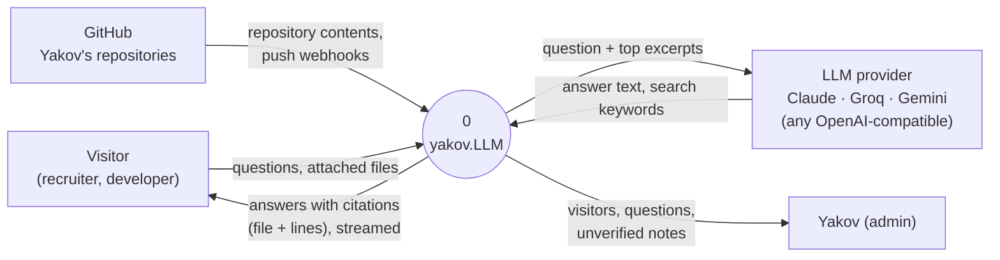
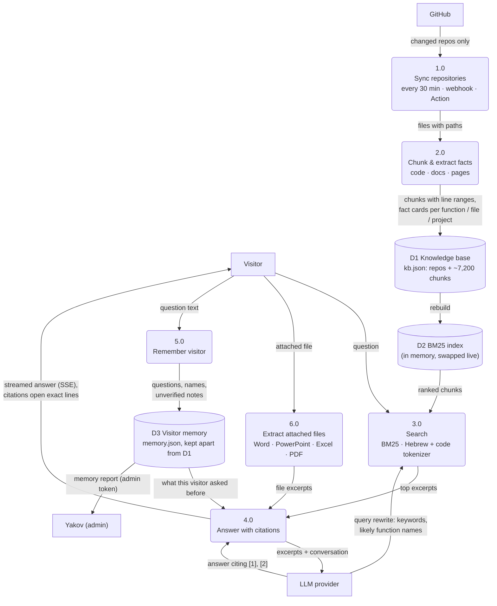
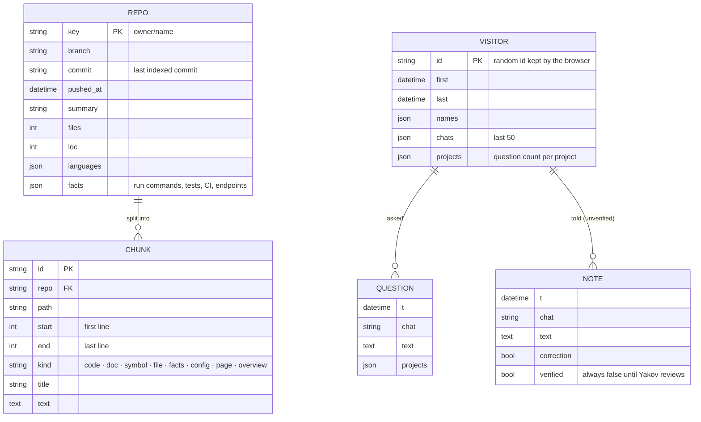

# yakov.LLM: Data Flow & Data Model

Drawn from the code: sync and indexing in [`yakovllm/sync.py`](../yakovllm/sync.py), [`chunker.py`](../yakovllm/chunker.py) and [`facts.py`](../yakovllm/facts.py), search in [`search.py`](../yakovllm/search.py), the HTTP API in [`server.py`](../yakovllm/server.py) and visitor memory in [`memory.py`](../yakovllm/memory.py). GitHub renders the diagrams directly.

**DFD notation:** rectangles are external entities, numbered rounded boxes are processes, cylinders are data stores.

## DFD Level 0: context diagram

## DFD Level 1

## Data model

yakov.LLM has no relational database: both stores are JSON documents. The diagram shows their structure as entities, so it is clear what is kept and how the parts relate.

Visitor memory never feeds the knowledge base: what a visitor says is stored only as an unverified note. Each visitor keeps at most 40 questions and 60 notes.
